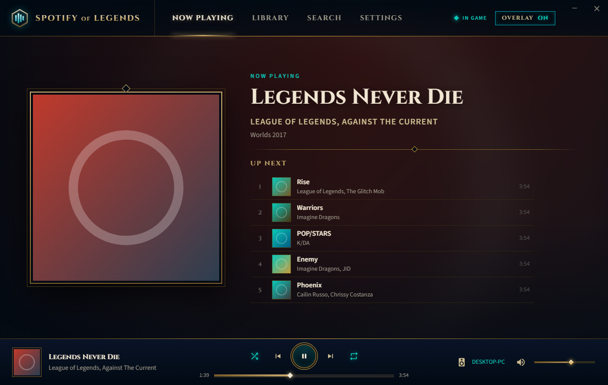
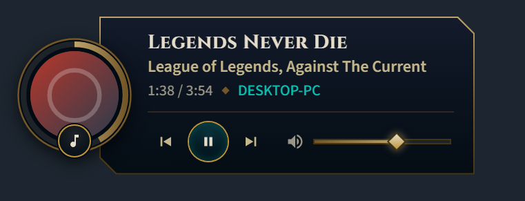
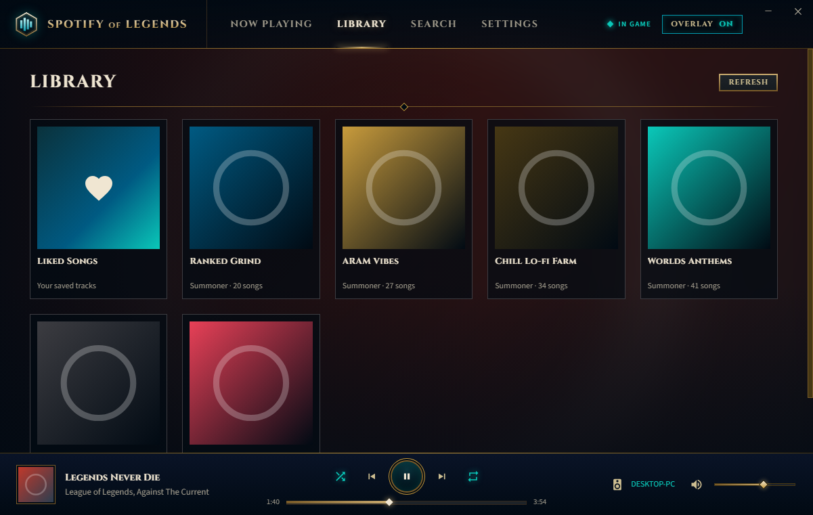
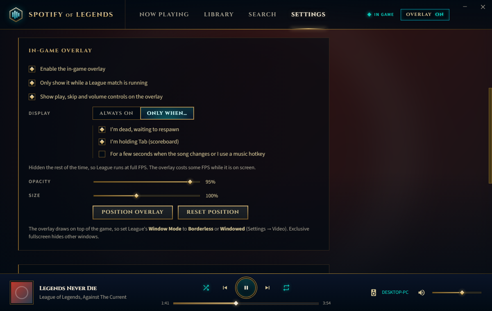

# Spotify of Legends

A Spotify client styled like the League of Legends client, with an optional in-game overlay that matches the League HUD. The overlay shows album art inside a gold ring that fills as the song plays, like the XP ring around a champion portrait.

- **Client window**: now playing (with the album art as a blurred splash background), up next, your playlists, search, device picker, and settings.
- **In-game overlay**: a small HUD widget drawn over the game. It's click-through by default so it never gets in the way, and it can show up automatically when a match starts.
- **Global hotkeys** for playback and the overlay, which work mid-game.

## Screenshots

The screenshots use sample data: the album art is placeholder art, not real covers.





| Library | Overlay settings |
| --- | --- |
|  |  |

## Setup

1. Install dependencies: `npm install`
2. Start the app: `npm start`
3. Link Spotify. The app walks you through this the first time:
   - Go to <https://developer.spotify.com/dashboard> and create an app. Any name and description will do.
   - Add the Redirect URI `http://127.0.0.1:8888/callback` and tick **Web API**.
   - Paste the app's **Client ID** into Spotify of Legends and click **Connect**.

**Requirements:** Spotify Premium, because the Web API only allows playback control on Premium accounts. Music plays through your Spotify desktop app or phone, and this app acts as the remote control. Spotify apps in Development Mode only work for the app owner and up to a few allowlisted users, which is fine for personal use.

## Using the overlay in League

- In League, set **Settings → Video → Window Mode** to **Borderless** (or Windowed). Exclusive fullscreen hides every other window, so the overlay can't draw on top of it.
- By default, the overlay appears only while a match is running. The app detects a match through Riot's official local [Live Client Data API](https://developer.riotgames.com/docs/lol#game-client-api) on `127.0.0.1:2999`. To keep the overlay visible all the time, untick "Only show it while a League match is running".
- Press **Ctrl + Alt + L** (or click **Position overlay** in Settings) to unlock the overlay. While it's unlocked you can drag it, use its controls, and change the volume. Lock it again and it goes back to being click-through.
- The overlay has play, skip and volume controls that you can click mid-game. It accepts clicks only while your cursor is over that controls row, so clicks everywhere else still reach the game. To hide the controls, turn them off in Settings.
- You can change the opacity and size in Settings.
- **FPS:** any window drawn over a borderless game stops the game from sending frames straight to the screen, which can cost a noticeable number of frames on high-refresh monitors. Set **Display** to **Only when…** in Settings to keep the overlay hidden except when you choose. You can combine these:
  - **while you're dead**, read from Riot's Live Client Data API;
  - **while you hold Tab**. The app reads the key's state without intercepting it, so the scoreboard still opens;
  - **for a few seconds** after a song change or music hotkey.
- **Hardware acceleration** is off by default, so the app doesn't compete with League for the GPU. Some graphics cards show a GPU-rendered overlay at lower cost, so you can turn it on in Settings → Performance (this requires a restart).

The overlay is an ordinary always-on-top window. It doesn't inject into the game or read game memory, so it works the same way as the Discord or Blitz overlays.

## Hotkeys

| Keys             | Action                     |
| ---------------- | -------------------------- |
| Ctrl + Alt + O   | Show / hide overlay        |
| Ctrl + Alt + L   | Unlock / lock overlay      |
| Ctrl + Alt + P   | Play / pause               |
| Ctrl + Alt + .   | Next track                 |
| Ctrl + Alt + ,   | Previous track             |
| Ctrl + Alt + =   | Volume up                  |
| Ctrl + Alt + -   | Volume down                |

Closing the window minimizes the app to the system tray, so the overlay and hotkeys keep working. To exit, right-click the tray icon and choose **Quit**.

## Project layout

```
src/main.js        windows, overlay logic, tray, hotkeys, playback polling
src/spotify.js     PKCE login, encrypted token storage, Web API calls
src/league.js      match and death detection via the Live Client Data API
src/keys.js        reads Tab / mouse-button state (no hooks) for the overlay
src/rules.js       pure overlay-visibility and queue rules, tested by `npm test`
src/store.js       settings persistence
src/preload.js     IPC bridge exposed to the pages as window.sol
src/renderer/      client + overlay pages; theme.css holds the Hextech palette and controls
scripts/make-icon.js  regenerates assets/icon.png
```

Settings and tokens are stored in `%APPDATA%\Spotify of Legends\`. Tokens are encrypted with Windows DPAPI through Electron's `safeStorage`.
